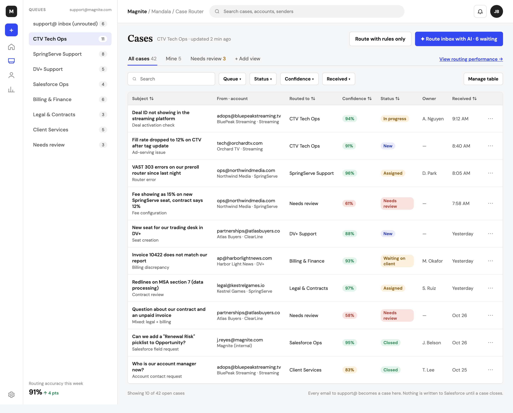
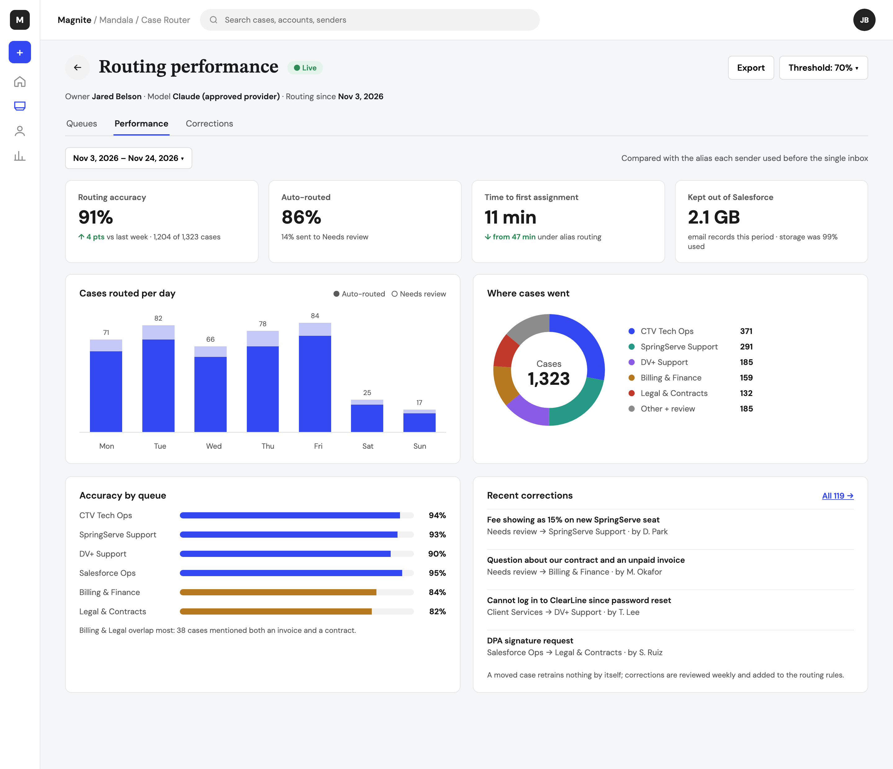
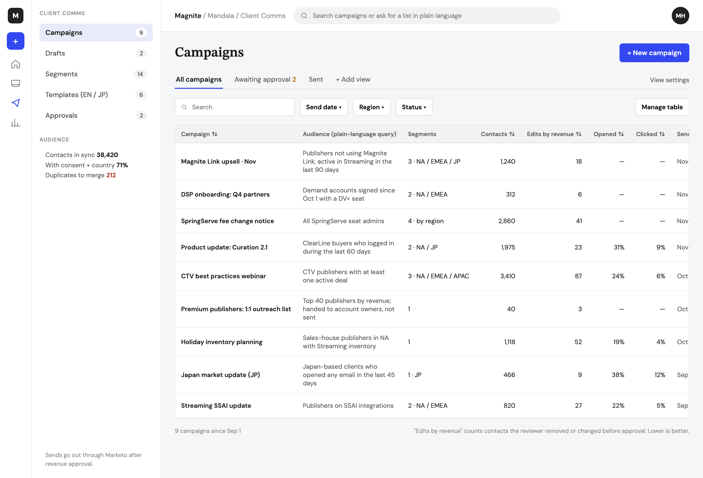
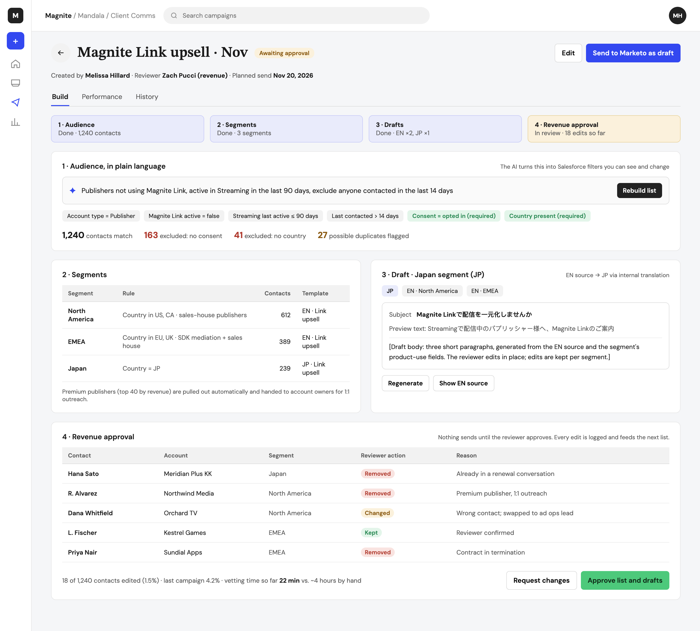

# Magnite Prototype

Two AI-assisted prototypes for **Mandala**, Magnite's internal operations platform. Both sit on top of Salesforce data and share one shell: a left app rail, a queue or view sidebar, a global search bar, and a table-first work area.

Design source: [Magnite Prototype Wireframes canvas](https://claude.ai/artifact/Y7N2N6mfc4HmhEveEFsb7j). Rendered images, browsable HTML, and the raw artboard sources live in [`wireframes/`](wireframes/).

| A1 · Case queue | A2 · Routing performance |
| --- | --- |
|  |  |

| B1 · Campaigns | B2 · Campaign builder |
| --- | --- |
|  |  |

## Prototype A · AI case routing

**Problem.** Every email to `support@magnite.com` lands in one inbox. Today a human reads each one and forwards it to the right team alias. First assignment takes about 47 minutes, and copying every email thread into Salesforce has pushed storage to 99% used.

**What we are building.** Every inbound email becomes a case. An AI model (Claude, the approved provider) classifies the intent, picks a queue, and attaches a confidence score. Cases above a threshold (70% by default) are routed automatically. Cases below it, or with mixed intent, land in a **Needs review** queue for a human. Nothing is written to Salesforce until a case closes.

**Queues.** support@ inbox (unrouted), CTV Tech Ops, SpringServe Support, DV+ Support, Salesforce Ops, Billing & Finance, Legal & Contracts, Client Services, Needs review.

**Screens.**

| Screen | File | What it shows |
| --- | --- | --- |
| A1 · Case queue | `wireframes/html/Main.html` | Case table with subject, detected intent, sender and account, routed queue, confidence pill, status, owner, received time. Filters by queue, status, confidence, date. Primary action: "Route inbox with AI · 6 waiting". Fallback: "Route with rules only". |
| A2 · Routing performance | `wireframes/html/RoutingPerformance.html` | KPI tiles (routing accuracy, auto-routed share, time to first assignment, data kept out of Salesforce), cases per day split auto vs review, share of cases by queue, accuracy by queue, recent human corrections. |

**Success metrics used in the wireframes.** Routing accuracy 91%, auto-routed 86%, time to first assignment 11 minutes (down from 47), 2.1 GB of email kept out of Salesforce per period.

**Key rules.**
- Confidence pills: green at 85% and above, amber 70 to 84%, red below 70%.
- A moved case does not retrain anything by itself. Corrections are reviewed weekly and folded into the routing rules.

## Prototype B · Client-comms campaign builder

**Problem.** Building a client email campaign means hand-pulling a Salesforce list, de-duplicating it, splitting by region, drafting copy per segment and language, and then having a revenue reviewer vet every contact. Vetting alone takes about four hours.

**What we are building.** A four-step builder where the user describes the audience in plain language. The AI turns that into visible, editable Salesforce filters, enforces consent and country requirements, splits the list into regional segments, drafts copy per segment (English source, Japanese via internal translation), and routes everything to a revenue reviewer. Approved campaigns go to Marketo as drafts. Nothing sends without approval.

**Builder steps.**
1. **Audience.** Plain-language query becomes filter chips. Consent and country are always required. Shows matches, exclusions, and flagged duplicates.
2. **Segments.** Rule, contact count and template per region. Top 40 premium publishers are pulled out automatically for 1:1 outreach by account owners.
3. **Drafts.** One draft per segment and language. Reviewer edits in place; edits are kept per segment. Regenerate or show the EN source.
4. **Revenue approval.** Every reviewer action (Removed, Changed, Kept) is logged with a reason. Edits feed the next list build.

**Screens.**

| Screen | File | What it shows |
| --- | --- | --- |
| B1 · Campaigns | `wireframes/html/Campaigns.html` | Campaign list with plain-language audience, segment count, contacts, edits by revenue, open and click rates, send date, status. Sidebar shows audience health: contacts in sync, share with consent and country, duplicates to merge. |
| B2 · Campaign builder | `wireframes/html/CampaignDetail.html` | The four-step builder for one campaign, with the approval table and "Approve list and drafts" action. |

**Success metric.** "Edits by revenue" per campaign. Lower is better. The sample campaign shows 1.5% of contacts edited vs 4.2% on the previous one, and 22 minutes of vetting vs about 4 hours by hand.

## Shared UI conventions

- Font: DM Sans for UI, STIX Two Text for page titles.
- Accent `#3348F0`. Status pills: blue for new or approved, amber for in progress or awaiting approval, green for closed or sent, red for needs review.
- Layout: 64px app rail, 232px sidebar, fluid main column at 1440px wide. Tables scroll horizontally below 1040px.
- Real `<button>`, `<a>`, `<input>` and `<label>` elements throughout, with `aria-label` on icon-only controls.

## Running the mock data app

Next.js 15 with Prisma 6 on Postgres, hosted on Supabase. The only credential is the database connection string.

1. Copy `.env.example` to `.env` and paste the two connection strings from the Supabase dashboard under Project Settings, Database. `DATABASE_URL` is the transaction pooler on port 6543 and `DIRECT_URL` is the direct connection on port 5432. `.env` is git-ignored.
2. Then:

```
npm install          # also generates the Prisma client
npm run db:reset     # creates the tables and loads the mock rows
npm run dev          # http://localhost:3000
```

The home page shows a tile per table with its row count. Each tile opens a paged table view of every row and column, including joined account and product names. `npm run db:studio` opens Prisma Studio for editing rows directly.

Other scripts: `db:push` applies schema changes without reseeding, `db:seed` reloads rows only, `typecheck` runs the TypeScript compiler.

**Resetting before a demo.** `npm run db:seed` wipes and reloads every table in about a minute. The data is deterministic, so the result is identical every time.

### Deploying the app

The database lives on Supabase. The app itself deploys to Vercel: import the GitHub repo, set the same two environment variables in the project settings, and deploy. The build runs `prisma generate` through the `postinstall` hook, so no extra build step is needed.

## Data model

Seven Salesforce-shaped tables in `prisma/schema.prisma`. Closed sets are plain strings and the accepted values are listed in a comment above each field.

| Table | Rows seeded | Key fields | Relations |
| --- | --- | --- | --- |
| Account | ~51 | type, region, country, ownerName, magniteLinkActive, streamingLastActiveAt, lastContactedAt, revenueRank | has many Contact, Opportunity, MagniteContract, Case |
| Contact | ~2,500 | email, title, consentOptIn, isPrimary, lastContactedAt, duplicateOfId | belongs to Account; self-relation for duplicates |
| Lead | 60 | status, source, consentOptIn, convertedAccountId, convertedContactId | optional link to Account and Contact once converted |
| MagniteProduct | 6 | code, name, family | has many Opportunity, MagniteContract |
| Opportunity | 60 | stage, amountUsd, closeDate, probability, renewalRisk | belongs to Account, optional MagniteProduct |
| MagniteContract | 55 | contractNumber, status, startDate, endDate, feePercent, msaVersion, dpaSigned, seatId | belongs to Account and MagniteProduct |
| Case | 1,323 | caseNumber, subject, intent, queue, initialQueue, confidence, status, routingMode, attachmentBytes, receivedAt, routedAt, assignedAt | optional Account and Contact; has many CaseCorrection |
| CaseCorrection | 119 | fromQueue, toQueue, correctedBy, reason | belongs to Case |

The seed has two layers:

- `prisma/seed/fixtures.ts` holds the exact accounts, contacts, cases and numbers that appear on the wireframes, so the screens and the designs agree. It includes a deliberate duplicate contact pair, a contract whose fee does not match the account's case, and two unrouted cases in the support inbox.
- `prisma/seed/generator.ts` adds volume around them from a seeded random generator: about 2,400 contacts of which 71% have consent and country, 5% suspected duplicates, plus 40 accounts, 54 leads, 52 opportunities and 45 contracts.
- `prisma/volume.ts` generates the 1,309 cases and 119 corrections behind wireframe A2, built backwards from its numbers (91% accuracy, 86% auto-routed, 11 minute median assignment, 2.1 GB kept out of Salesforce) so the metrics endpoint reproduces the dashboard exactly. See [`docs/prototype-a.md`](docs/prototype-a.md).

## Repository layout

```
README.md
package.json           Next.js app scripts, Prisma seed hook
prisma/
  schema.prisma        the seven mock tables
  seed.ts              loads fixtures, generated rows and case volume
  seed/                wireframe fixtures and the generator for the six non-case tables
  volume.ts            case history behind wireframe A2
src/
  app/                 data browser (/), A1 case queue (/cases), A2 dashboard (/routing-performance), API routes
  lib/                 Prisma client, table registry, case router, email ingest, routing metrics
wireframes/
  README.md              screen-by-screen notes and open questions
  images/                PNG renders of each screen at 2x (1440px wide)
  html/                  standalone HTML for each screen, opens in any browser
  canvas-source/         exact artboard sources exported from the design canvas
```

## Status

Wireframes, a seeded Supabase database with a read-only browser, and Prototype A (case routing: screens A1 and A2, the case and metrics endpoints, and 21 tests via `npm test`). Prototype B is in progress on the `b1-campaigns` branch. See [`wireframes/README.md`](wireframes/README.md) for the screen inventory and open questions.
