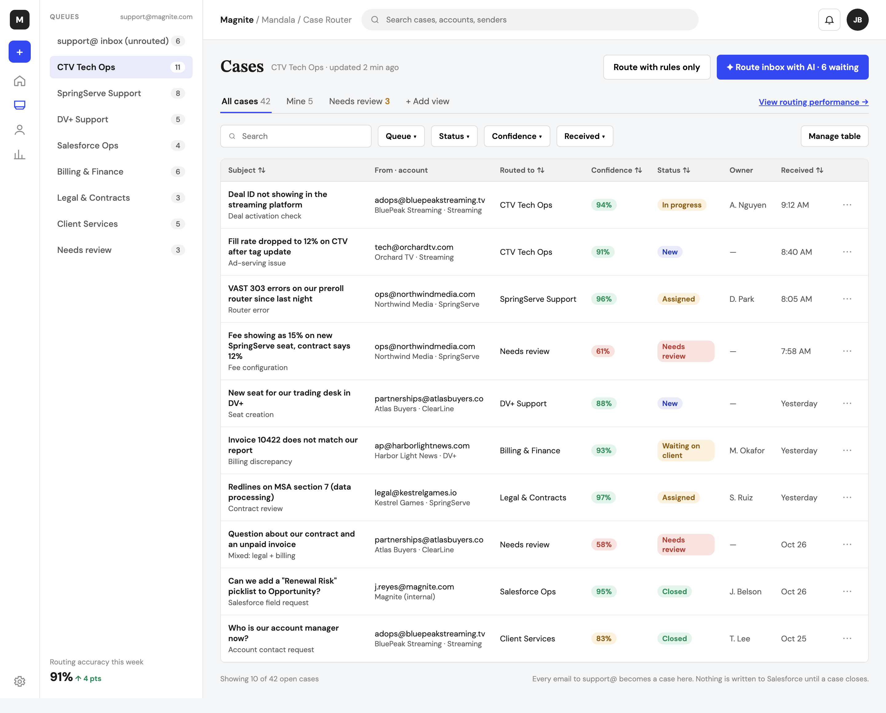
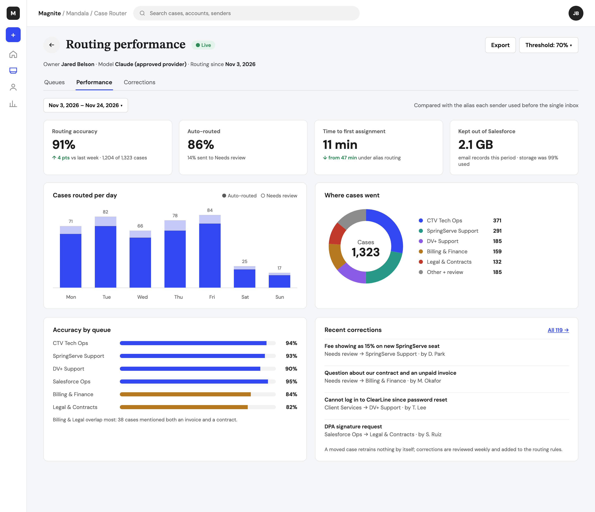
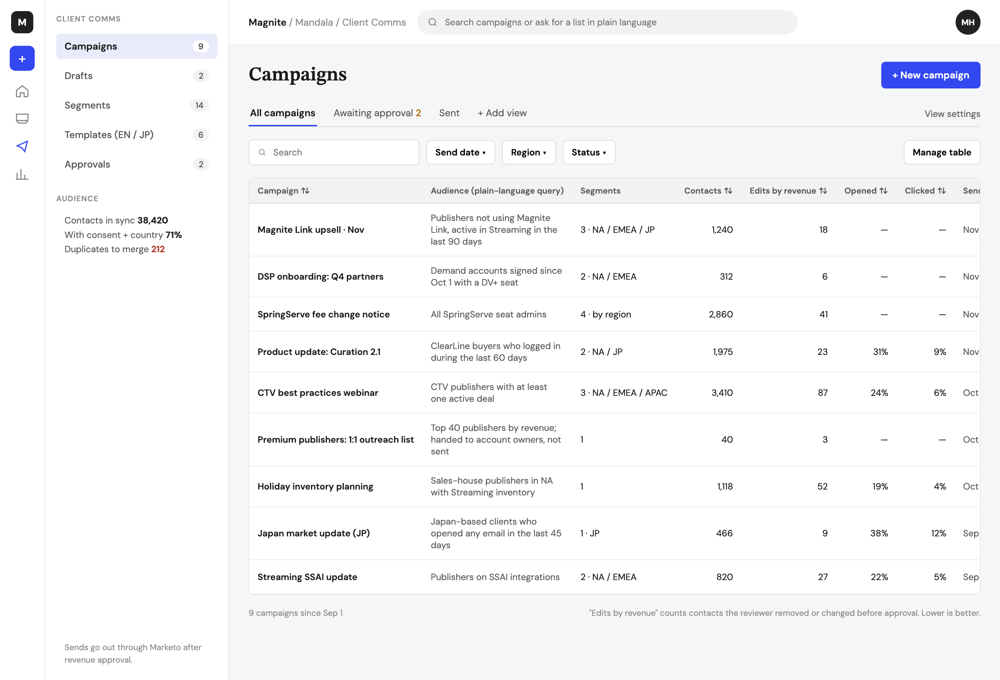
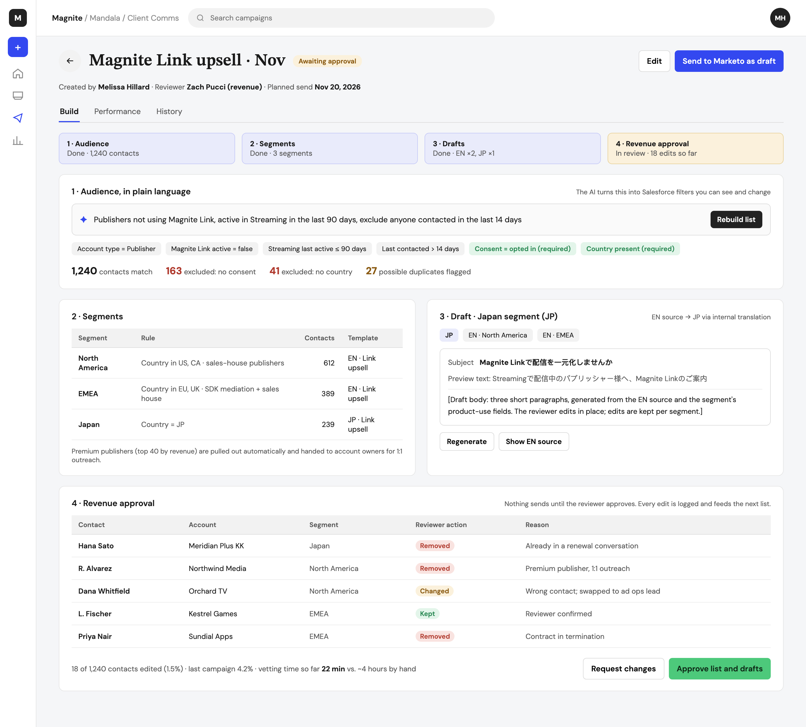

# Wireframes

Source of truth is the [Magnite Prototype Wireframes canvas](https://claude.ai/artifact/Y7N2N6mfc4HmhEveEFsb7j). Everything here was exported from it on 2026-11-23 and should be re-exported, not edited by hand, when the canvas changes.

Three forms of each screen:

- `images/` holds PNG renders at 2x resolution, 1440px wide. Use these in docs, tickets and slides.
- `html/` holds standalone HTML with the sample data baked in. Open any file directly in a browser. Links between screens work.
- `canvas-source/` holds the raw artboard files. Each is a Design Component page: a `<x-dc>` block of HTML with inline styles plus a script that supplies sample data. These only render inside the canvas viewer.

## Screen inventory

| ID | Title | Image | HTML | Size | Links to |
| --- | --- | --- | --- | --- | --- |
| A1 | Case queue | `images/A1-case-queue.png` | `html/Main.html` | 1440 × 980 | A2 via "View routing performance" |
| A2 | Routing performance | `images/A2-routing-performance.png` | `html/RoutingPerformance.html` | 1440 × 1240 | A1 via back arrow |
| B1 | Campaigns | `images/B1-campaigns.png` | `html/Campaigns.html` | 1440 × 980 | B2 via "+ New campaign" |
| B2 | Campaign builder | `images/B2-campaign-builder.png` | `html/CampaignDetail.html` | 1440 × 1300 | B1 via back arrow |

`canvas-source/canvas.json` holds the artboard positions and the two row titles on the canvas. The A1 image is captured taller than its artboard so all ten sample rows are visible. The B1 table is wider than 1440px and scrolls horizontally in the design, so its last two columns are clipped in the image, as they are on the canvas.

## A1 · Case queue

- Sidebar lists nine queues with open counts and a "Routing accuracy this week" stat.
- Header: breadcrumb `Magnite / Mandala / Case Router`, global search, notifications, avatar.
- Tabs: All cases, Mine, Needs review (count in amber), + Add view.
- Filters: search, Queue, Status, Confidence, Received, Manage table.
- Table columns: Subject with detected intent underneath, From and account, Routed to, Confidence pill, Status pill, Owner, Received, row menu.
- Footer note: "Every email to support@ becomes a case here. Nothing is written to Salesforce until a case closes."

## A2 · Routing performance

- Header strip: Live badge, Export, Threshold selector (70%), owner, model, routing start date.
- Tabs: Queues, Performance, Corrections.
- Date range picker compared against the old alias-based routing.
- Four KPI tiles, then four cards: cases per day (stacked auto vs review), share by queue (donut), accuracy by queue (bars, amber below 90%), recent corrections with who moved what.

## B1 · Campaigns

- Sidebar views: Campaigns, Drafts, Segments, Templates (EN / JP), Approvals. Audience health block below.
- Search placeholder invites a plain-language list request.
- Tabs: All campaigns, Awaiting approval, Sent, + Add view.
- Table columns: Campaign, Audience query, Segments, Contacts, Edits by revenue, Opened, Clicked, Send date, Status.
- Statuses: Awaiting approval, Approved, Sent, Handed off.

## B2 · Campaign builder

- Header: back arrow, campaign title, status pill, Edit, "Send to Marketo as draft". Creator, reviewer and planned send date underneath.
- Tabs: Build, Performance, History.
- Step progress row: Audience, Segments, Drafts, Revenue approval.
- Audience card: editable plain-language query, Rebuild list, filter chips with required consent and country chips in green, match and exclusion counts.
- Segments card: region, rule, contacts, template.
- Draft card: segment tabs, subject and preview text, body placeholder, Regenerate, Show EN source.
- Approval card: contact, account, segment, reviewer action pill, reason. Footer compares edit rate and vetting time to the last campaign. Actions: Request changes, Approve list and drafts.

## Open questions before build

- Where does the confidence threshold live, per queue or global? The wireframe shows one global value.
- What happens to a case that a human moves out of Needs review? A2 says corrections retrain nothing automatically, so a weekly review workflow needs its own screen or process.
- Which Salesforce objects back the audience filters, and who owns the field mapping for consent and country?
- Marketo handoff: is "Send to Marketo as draft" available before approval, as the header suggests, or only after?
- Translation: the JP draft comes from an internal translation step. Is that a service call or a human step?
- Row menus, Manage table, View settings and the Performance and History tabs on B2 have no wireframe yet.
